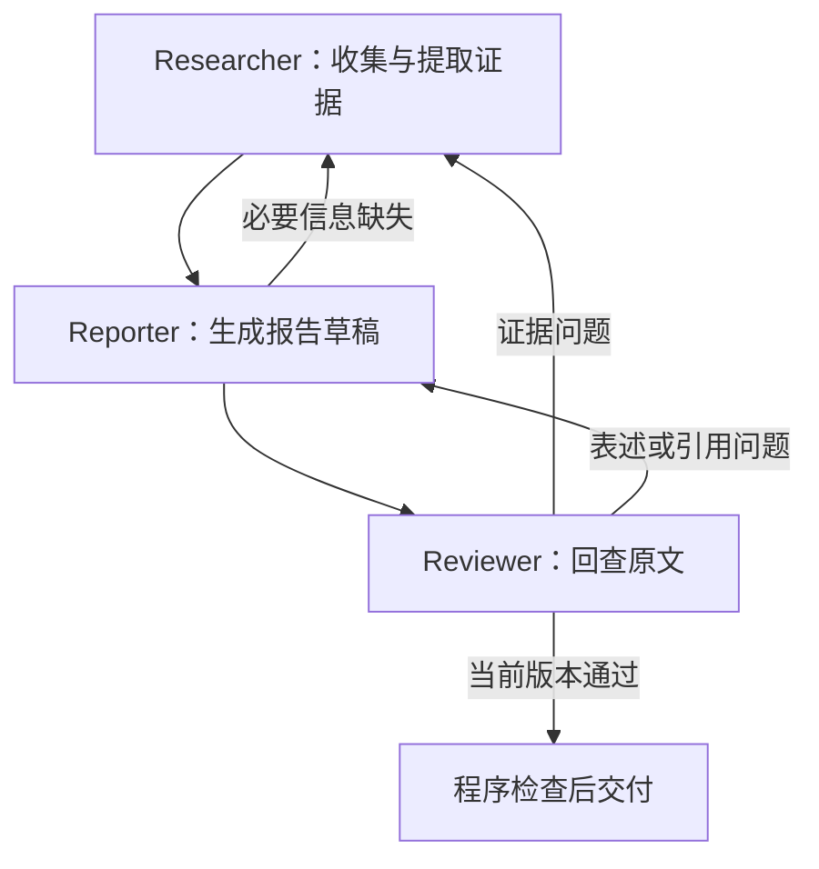

# 三 Agent 学术文献研究助手

**英文项目名称：** Multi-agent AI Research Assistant for Academic Literature Review\
**文档版本：** v0.1\
**更新日期：** 2026-11-12\
**项目阶段：** 设计阶段\
**实现状态：** 尚未实现；尚未运行系统、测试或实验。

> 本文介绍拟实现的系统及使用方式。文中的功能、接口、配置与运行流程均属于设计约定，不代表已经具备对应能力。

## 1. 项目简介

本项目拟使用 LangChain 构建三个职责明确的 Agent，协助用户围绕一个研究问题完成文献检索、证据整理、综述写作和原文审核。

系统支持三种论文来源：

- **本地模式：** 使用用户上传的文献。
- **联网模式：** 搜索论文，并核验其身份后再使用。
- **混合模式：** 利用上传文献，针对研究缺口补充联网检索。

系统拟输出综述报告、文献比较表、参考文献、证据定位和未解决问题。核心结论应能够追溯到实际读取的原文及文档版本。

## 2. 使用场景

典型用户是一名准备开题报告的研究生，希望回答：

> 在多跳问答任务中，迭代检索相较于一次检索能够带来什么改善？这些改善是否伴随更多检索或模型调用成本？哪些结论具有明确的适用条件？

用户可以上传已有论文，也可以允许系统联网补充文献。

系统需要帮助用户：

1. 找到与研究问题相关的论文。
2. 提取方法、数据集、模型、效果和成本等信息。
3. 区分可以比较与不能直接比较的结果。
4. 形成有依据的综合结论。
5. 标明证据不足、原文无法取得和研究结果存在分歧的部分。

上述场景用于说明设计目标，不是已完成的系统运行记录。

## 3. 三个 Agent

| Agent | 主要职责 | 主要产物 |
| --- | --- | --- |
| **Researcher：文献研究员** | 检索、筛选、阅读文献，提取原文证据，响应补证请求 | 论文与证据 ID、实验条件、问题覆盖情况、资料缺口 |
| **Reporter：报告与结论生成员** | 综合证据、组织报告、形成有条件的结论，识别覆盖缺口 | 报告草稿、主张与证据映射、补证请求、限制说明 |
| **Reviewer：证据审核员** | 回读原文，检查事实、引用、比较条件和推论范围 | 审核结论、具体问题、处理责任方、未检查项 |

任务路由、字段校验、工具权限、预算和版本控制由普通 Python 程序负责。

## 4. 第一版范围

### 4.1 拟实现

- 明确的研究问题与子问题。
- 本地、联网和混合来源模式。
- 对可提取文本的 PDF 进行读取和定位。
- 对在线论文进行身份核验。
- 区分论文身份、文档对应关系和结论支持关系。
- 结构化证据、报告主张和审核问题。
- 有上限的补证与修改流程。
- 报告、证据和审核结果的版本关联。
- 可复核的运行记录与验收样例。

### 4.2 第一版不覆盖

- 对整个研究领域进行穷尽检索的保证。
- 自动完成正式系统综述或元分析的全部方法学要求。
- 自动执行论文实验或验证实验数据真伪。
- 对复杂扫描件、公式和表格进行无误解析的保证。
- 绕过文献访问权限获取全文。
- 自动向外部平台发表或发送报告。

## 5. 论文来源与核验原则

### 本地模式

默认只使用用户上传资料。联网核验上传文献的书目信息由独立设置 `allow_local_metadata_lookup` 控制，默认关闭。

未进行外部身份核验的上传文件可以参与分析，但必须标为：

> 用户提供的文档；公开发表身份未外部核实。

没有出版信息时，应保留未知值，不得补写期刊、年份或 DOI。

### 联网模式

在线候选必须取得实际工具返回的权威来源记录，并完成身份匹配，才能作为已核验的在线论文引用。

以下情况不能直接视为身份核验通过：

- 模型生成了一个看起来合理的论文标题或 DOI。
- 普通搜索页面出现了相关摘要。
- 某个 URL 可以打开。
- 某个 DOI 真实存在，但对应的是另一篇论文。

### 混合模式

两类来源保留各自的来源标签。预印本与正式版可以关联，但证据必须绑定实际读取的版本，不能将同一研究的多个版本当成多项独立研究。

## 6. 拟定技术方案

| 项目 | 设计选择 | 当前状态 |
| --- | --- | --- |
| 开发语言 | 拟采用 Python 3.12；依赖兼容性待实现时确认 | 未验证 |
| Agent 框架 | LangChain `create_agent` | 已选定方向，未实现 |
| Agent 间编排 | 普通 Python 程序 | 未实现 |
| 结构化协议 | Pydantic schema | 字段在 DESIGN.md 中定义 |
| 项目数据 | SQLite | 未实现 |
| 原始材料 | 文件存储与内容哈希 | 未实现 |
| 文献内检索 | 可替换的全文/向量检索组件 | 具体组件待选 |
| 模型与 embedding | 支持所需工具调用和结构化输出的模型 | 型号与配置待选 |
| 外部文献服务 | 学术检索接口、DOI 注册记录、预印本或出版机构记录 | 待接入 |

LangChain 及其他依赖的确切版本应在实现阶段锁定。当前没有依赖锁文件，也没有完成安装兼容测试。

## 7. 配置与拟定使用流程

### 7.1 配置类别

实现阶段需要明确：

- 模型提供方、模型 ID、参数和凭证引用方式。
- embedding 与检索配置。
- 学术服务地址及所需凭证。
- 资料模式和本地文献元数据联网开关。
- 文献数量、调用次数、时间和返工预算。
- 文件、数据库和日志位置。

凭证通过运行环境或受控配置提供，不写入公开文档、提示词或运行日志。

### 7.2 使用流程

1. 配置模型与需要使用的外部服务。
2. 输入研究问题、范围和需要比较的维度。
3. 选择资料模式并上传可选文献。
4. 程序登记材料，执行三 Agent 流程。
5. 查看文献状态、补证任务和审核问题。
6. 获取报告与证据定位，检查未解决事项。

**当前没有可执行启动命令或测试命令。**实现完成后，应在本节补充真实入口、配置样例和经过验证的操作步骤。

## 8. 完整示例的预期过程

以下为设计示例，未执行：

1. 用户上传若干有关多跳问答的论文，选择混合模式。
2. Researcher 提取效果数据，发现部分论文缺少成本信息。
3. Reporter 形成比较草稿，并提出明确的成本补证请求。
4. Researcher 查阅相关章节或补充检索，返回实际找到的信息及缺失情况。
5. Reviewer 发现草稿把不同模型下的结果直接排名，要求修改。
6. Reporter 改为有条件的比较，并说明无法直接比较的原因。
7. Reviewer 检查修订稿；程序确认报告、证据和审核版本一致后交付。

预期产物包括：

- 综述正文与比较表。
- 可解析的引用及来源信息。
- 关键主张的原文位置。
- 资料不足与研究分歧说明。
- 本次任务的检索、反馈和审核记录。

## 9. 测试与验收入口

验收方案见 EVALUATION.md，重点包括：

- 真实论文与错误身份的区分。
- 正确论文记录搭配错误 PDF 的处理。
- 本地未核验稿件的来源标识。
- 无结果、超时、全文不可取得的不同状态。
- 证据错误和报告错误的定向返工。
- 不存在的引用 ID 拦截。
- 审核版本过期后的处理。
- 达到预算后停止并保留问题。

当前所有测试均为“未执行”。不得将设计检查完成写成系统测试通过。

## 10. 实施顺序

| 阶段 | 拟完成内容 | 当前状态 |
| --- | --- | --- |
| M0 | 审阅三份设计文档，确认范围与契约 | 待团队审阅 |
| M1 | 本地文件、证据库、三 Agent 基本流程 | 未开始 |
| M2 | 在线身份核验与文档对应检查 | 未开始 |
| M3 | 定向返工、预算和版本校验 | 未开始 |
| M4 | 固定样例验收与对照实验 | 未开始 |

## 11. 已知限制

- 论文身份核验不等于研究结论可靠。
- Reviewer 的判断仍可能错误，需要固定评测和人工抽查。
- 不同论文的实验条件可能无法直接比较。
- 元数据与全文服务可能存在覆盖不足、限流或暂时不可用。
- 文档解析可能错误，尤其是表格、公式与扫描件。
- 三 Agent 的质量收益与成本尚未通过实验确认。

## 12. 文档关系

- **README.md：** 项目概览、使用流程、配置规划和当前状态。
- **DESIGN.md：** 需求、Agent 契约、数据、工具、协作与异常设计。
- **EVALUATION.md：** 验收样例、实验方案、通过标准和运行记录模板。

三份文档以 DESIGN.md 中的需求编号和协议定义为共同基线。协议改变时，应同步检查另外两份文档的相关内容。
